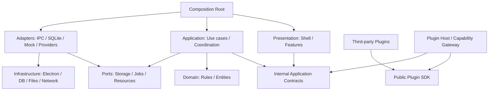
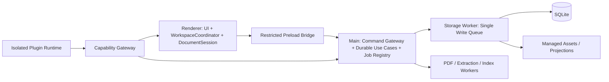
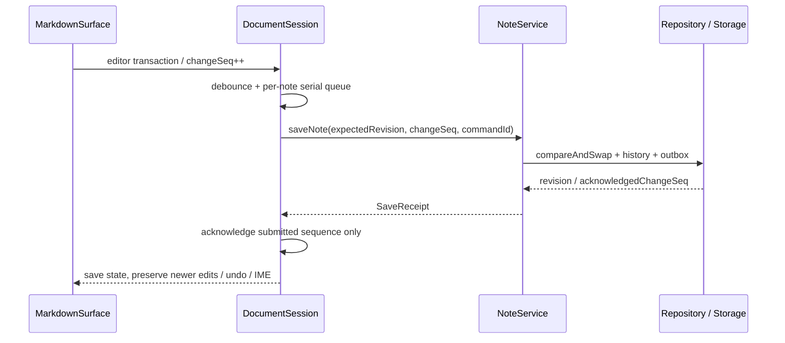

# Syna 新工程架构与开发方案 v1.0

> **本工程当前执行边界（2026-10-13）**：用户已授权 P3.0 Library Explorer：真实 Folder / Placement、目录操作、排序、拖拽、软删除与恢复。P2 的编辑器、DocumentSession、CAS 与三种模式保持原有边界；完成 P3.0 后停止，不自动推进其他业务。所有开发与 E2E 使用新工程隔离工作区，旧工程只读。下方尚未落地的 P3 资源管理及 P4–P7 接口仍是目标设计；历史相对链接保留作出处说明。
>
> 当前已落地：保留 Shell、独立 Navigation/Layout 与唯一 Renderer composition；新增 Note contracts、共享 NoteService、DocumentSession、NotesWorkspace、SQLite Storage Worker 与受限 notes bridge。Focus/viewport 不改写偏好，编辑正文由 CodeMirror EditorState 唯一拥有。Reader、真实 AI、Inbox 捕获与插件宿主仍未接入。运行入口及限制见 README。
>
> **P1a 交互调整（2026-10-13）**：Rail 的 `activatePage` 恢复 Navigation 中各入口最近位置；再次激活当前 Workspaces / Library 复用 Layout 的 `toggleSidebar`，不导航。已访问工作面及上下文侧栏保活，滚动/输入/树状态留在 Presentation，本次会话结束后不保留；跨启动仅保存 UI 布局偏好。Dashboard / Inbox / Search 无 ContextSidebar；Focus 与窄屏仍只影响 Effective Layout。侧栏标题不设折叠按钮，标题/行高为 44px/32px。
>
> **P1a 工具操作精简（2026-10-13）**：删除 Workspace Actions；Focus 使用固定位置的进入/退出图标与快捷键 tooltip，保留独立 Auxiliary Panel 开关。Rail 底部增加主题切换，Settings Appearance 支持 System / Light / Dark。Requested 主题偏好持久化；系统主题通过 Renderer adapter 订阅，解析后的深浅主题不写回偏好，不改变 Navigation / 面板状态。保留原配置目录以延续已有 UI 偏好，正式窗口标题为 Syna。

日期：2026-10-12。状态：**新项目的目标设计，尚未实现的接口草案**。

本文是新工程的单一架构依据，覆盖产品边界、模块依赖、状态归属、内部契约、插件 SDK、存储、安全和开发验收。它不要求在当前旧工程中立刻重构，也不表示文中的包、API、数据库表或命令已经存在。

依据为已完整阅读的 `docs/development.md`、`Syna_UI_Interaction_Spec_v1.0.md` 和此前讨论。UI 规格继续定义产品体验；其中“在旧工程中增量改造”的执行要求，按这次“重新建立项目”的明确请求调整为新工程建设。旧实现只作为可选择复用的技术资产和数据导入来源。

阅读路径：[总体依赖](#3-分层依赖与进程边界) · [状态归属](#6-状态归属) · [Markdown 闭环](#9-markdown-最小纵向闭环) · [插件 SDK](#13-内部-application-api-与公开-plugin-sdk) · [插件权限](#14-插件运行时权限与版本) · [开发路线](#17-分阶段开发与验收) · [旧工程处理](#19-旧工程能力与数据如何处理)。

## 1. 先确定的架构决策

采用 **模块化单体 + Contract-first + 单一持久化入口 + 受限插件宿主**。

1. 新 Shell 独立建设，不导入旧 `App.tsx`，不围绕旧页面状态设计新接口。
2. UI 通过 Application API 表达意图；Application 通过 Ports 依赖基础设施。
3. Navigation、Layout、Document、Session 分别拥有自己的状态，由工作区协调器协调切换。
4. SQLite 是用户业务数据的权威来源；Markdown 文件是可导出、可重建的投影。
5. 第一个真实闭环是 Markdown 创建、编辑、保存、切换、恢复，随后扩展业务。
6. 内部 Application API 和公开 Plugin SDK 分开设计、分开版本管理。
7. 插件通过宿主声明贡献、读取授权内容、提出操作；不获得应用内部对象或数据库访问权。
8. 内置核心功能先做可靠，不为“万物皆插件”增加启动、保存和调试成本。

| 选择 | 首版决策 | 理由与边界 |
| --- | --- | --- |
| 桌面运行时 | Electron + TypeScript | 复用已验证的桌面、PDF、AI 技术能力；权限保留在主进程 |
| UI | React + Vite，CSS 变量设计令牌 | Shell 与业务可独立调试；不强制复杂状态框架 |
| 编辑器 | CodeMirror 6 的 Markdown 编辑核心 | 文本事务、撤销、选区和中文输入由编辑器负责 |
| PDF | PDF.js + 独立解析 Worker | 不自行重写 PDF 引擎 |
| 存储 | SQLite + 受管资源目录 | 正文、版本、关系、历史有统一事务边界 |
| 运行时校验 | Zod 或同类 schema，选定一种 | IPC、插件调用、导入不能只依赖 TS 类型 |
| 工程 | npm workspaces，少量本地包 | 一个仓库、一套构建；暂不引入微服务、消息中间件 |
| 首版范围 | 单用户、本地工作区、单窗口 | 多窗口、同步、协作后续单独设计并发协议 |
| 插件范围 | 先命令、声明式视图、读取与编辑提案 | 自由 DOM、Node 插件、插件市场不进入首个闭环 |

这些是技术选型，不是依赖版本清单。创建工程时核对当时稳定版本、Electron 原生依赖和打包兼容性，再固定 lockfile。

## 2. 产品结构与核心不变量

全局导航固定为 `Dashboard → Inbox → Workspaces → Library → Search`，Settings 位于底部。AI、Reader、Trash 不增加一级图标：AI 是上下文能力，Reader 是内容工作面，Trash 属于 Library。

| 页面 / 能力 | 主要职责 | 数据归属 |
| --- | --- | --- |
| Dashboard | 继续工作、快捷笔记、输入捕获、少量关注项 | 聚合查询，不另存一份笔记或任务 |
| Inbox | 捕获、提取、判断建议、用户分流 | Capture、Source、Assessment、用户决定 |
| Workspaces | Pipeline、Project、Stage、Task | 项目实体及内容引用关系 |
| Library | Notes、References、Assets、Collections、Trash | 跨项目的统一内容实体 |
| Reader | PDF / 网页阅读、定位、批注、引用 | SourceRevision、ReadingRecord、Annotation |
| Editor | 用户文档编辑、保存状态、历史和审阅 | NoteDocument、DocumentSession |
| Assistant | 上下文对话、任务、建议与审阅 | Conversation、AIJob、ContextSnapshot、Proposal |
| Search | 跨域发现与跳转 | 可重建索引；结果指向稳定实体 ID |

必须始终成立：

- Note、Source、Asset 的身份与路径、标题、所在项目无关。
- 同一 Note 可关联多个 Project；解除关联不删除 Note。
- 删除正文中的图片引用不删除 Asset；未引用不等于允许自动删除。
- 保存冲突不自动覆盖；失败导航不丢草稿；隐藏 AI 面板不终止后台任务。
- AI 建议与用户确认的数据分开；没有全文时不能声称分析了全文。
- 未接入的能力显示真实空状态或禁用原因；正式版不填充演示结果。
- 禁用插件后，用户数据、未知块、原始资源和可读回退仍然存在。

## 3. 分层、依赖与进程边界

### 3.1 逻辑依赖



箭头表示允许的代码依赖，不代表所有调用发生在一个进程。`composition.ts` 负责组装；业务模块不能反向 import Shell。

明确禁止：

- `features/*`、`shell/*` 直接引用 Electron、Node、SQLite、preload 或 `window.syna`。
- Domain / Application import React、CodeMirror、PDF.js 或具体 AI SDK。
- 插件 import `@syna/core`、内部 store、`@syna/contracts` 或私有 IPC。
- 为了跨模块方便创建可随意读写所有状态的全局 `SynaService`。

### 3.2 运行时分配



| 位置 | 拥有的职责 | 不拥有的职责 |
| --- | --- | --- |
| Renderer | 导航历史、布局意图、编辑缓冲、工作面、工作区切换协调 | 文件读写、密钥、数据库连接 |
| Main | 校验调用者、持久化用例入口、任务注册与取消、窗口和插件权限 | 处理每次光标变化、大量 PDF 解析 |
| Storage Worker | 串行写入、事务、版本检查、历史、outbox | UI 布局、编辑器生命周期 |
| 专用 Worker | PDF / 正文提取 / 索引等重任务 | 自主改写笔记和导航状态 |
| Plugin Runtime | 执行插件逻辑、生成受限视图描述 | 访问主界面 DOM、Node、数据库或凭据 |

Application 是逻辑层，可以分布在 Renderer 与 Main。**Renderer 的工作区协调器只有一个；Main 的持久化用例只有一套**。不会在两个进程分别建立可写的完整“当前工作区 store”。跨进程交换 DTO、命令结果和已提交事件。

首次实现只需要按此边界组织代码，不必把每一个领域都拆成 Worker。Storage Worker 与插件隔离是有实际运行需求的边界。

## 4. 新工程目录

```text
syna/
├── apps/desktop/
│   ├── src/main/                 # 启动、窗口、协议、IPC、任务和权限
│   │   ├── composition.ts
│   │   ├── ipc/
│   │   ├── jobs/
│   │   └── plugins/              # 宿主、贡献注册表、权限网关
│   ├── src/preload/              # 仅固定白名单桥接
│   ├── src/renderer/
│   │   ├── app/                  # AppShell、Provider、composition
│   │   ├── shell/                # Rail、Sidebar、Header、PanelHost
│   │   ├── features/             # 按实际接入功能建立目录
│   │   │   ├── dashboard/
│   │   │   └── editor/
│   │   └── adapters/             # IPC client、编辑器/工作面适配器
│   └── src/workers/
├── packages/contracts/src/       # 内部 DTO、接口、错误与运行时 schema
├── packages/core/src/
│   ├── workspace/                # 导航、DocumentSession、现场协调
│   ├── layout/                   # 纯布局模型与推导
│   ├── notes/                    # 领域规则、用例、Repository Port
│   └── testing/                  # Mock ports、时钟、故障注入
├── packages/storage/src/         # SQLite adapter、迁移、资源与投影
├── packages/plugin-sdk/src/      # 公开类型、SDK client；P6 开始建立
├── examples/plugins/             # 可独立编译的示例；P6 开始建立
├── tests/                        # 契约、集成、桌面回归
├── docs/architecture.md          # 本文在新工程中的唯一维护版本
├── package.json
└── README.md                     # 安装、启动、检查；链接架构文档
```

前四个包按需建立；SDK 包等到首个插件用例出现再创建。新功能先在 `core/<feature>` 下组织 domain、use cases、ports，达到清晰边界后再考虑独立包。不要提前建立十几个空 Service 和空页面目录。

建议让 lint / dependency 检查自动执行第 3 节的禁用依赖规则。不能只靠开发者记住分层。

## 5. 领域模型与数据契约

### 5.1 实体和关系

| 实体 | 身份 / 版本 | 规则 |
| --- | --- | --- |
| Workspace | `workspaceId`，schemaVersion | 一个业务数据库及受管资源根目录；不是一个 Project |
| NoteDocument | `noteId`，revision | 标题、Markdown、块身份、扩展数据组成一个版本 |
| BlockIdentity | `blockId`，随文档版本更新 | 编辑映射维护身份，禁止每次解析随机重建 |
| Asset / AssetRevision | 稳定 ID、不可变原件版本 | 文件哈希可用于字节去重，不能代替来源或引用身份 |
| Source / SourceRevision | 来源 ID、不可变内容快照 | URL 相同不保证内容版本相同；定位和引用绑定版本 |
| Capture | `captureId` | 一次输入行为，可指向已有 Source |
| Reference | `referenceId` → Source | 用户保存参考的意图，不复制 Source |
| ReadingRecord / Annotation | SourceRevision + locator | 阅读进度与用户批注，允许没有关联 Note |
| Pipeline / Project / Stage / Task | 各自稳定 ID | Pipeline 为流程模板/分类；项目阶段与任务引用稳定 ID |
| ContentLink | linkId + project/stage + target | 多对多关系；删除关系不级联删除目标内容 |
| Collection / Placement | 集合 / 展示位置 ID | 组织方式，不能成为内容所有权 |
| AIJob / ContextSnapshot / Proposal | jobId / snapshotId / proposalId | 记录模型、输入版本、证据范围与审阅结果 |
| WorkScene / RecoveryDraft | sceneId / draftId | 现场只记录位置与引用；恢复草稿另外保存 |
| TrashEntry | entryId + deletion batch | 保存删除前状态及关系，支持安全恢复 |

ID 使用宿主生成的不可猜测稳定字符串，TypeScript 使用品牌类型区分。不要把路径、数组下标、标题或 URL 当作可变实体主键。revision 为宿主递增整数，不由客户端猜测。

### 5.2 文档的权威表示

新工程选定：**Markdown 是正文的权威表示；块身份、扩展块、引用等是与正文一起版本化的结构元数据**。

- CodeMirror EditorState 是编辑缓冲，不能另建一份不断互相覆盖的 React `markdown` state。
- AST、阅读 HTML、docJson、搜索文本是派生表示；新工程不同时维护多个独立可写正文模型。
- 初期不引入协同 CRDT。旧数据中的 `yState`、docJson 或未知扩展可由导入器保留为有版本的兼容数据，不能把它们错误地宣称为新工程已支持的协同能力。
- 块身份映射、扩展 envelope、公式/引用关系在同一次正文保存中提交。后续 schema 增加字段时，老客户端不能用“全量覆盖对象”把未知字段清空。
- 扩展更新采用显式 mutation；正文编辑导致的块变化由内置映射器确定，未知 payload 原样保存。

### 5.3 最小通用契约

下文所有 TypeScript 片段共同构成一组可做类型检查的目标接口。它们是 API 形状与语义约束，不是运行时实现。

```ts
export type Id<K extends string> = string & { readonly __kind: K };
export type WorkspaceId = Id<'workspace'>;
export type NoteId = Id<'note'>;
export type ProjectId = Id<'project'>;
export type StageId = Id<'stage'>;
export type SourceId = Id<'source'>;
export type SourceRevisionId = Id<'source-revision'>;
export type AssetId = Id<'asset'>;
export type AssetRevisionId = Id<'asset-revision'>;
export type BlockId = Id<'block'>;
export type SceneId = Id<'scene'>;
export type JobId = Id<'job'>;
export type ProposalId = Id<'proposal'>;
export type CommandId = Id<'command'>;
export type Revision = number;
export type JsonValue = null | boolean | number | string
  | readonly JsonValue[] | { readonly [key: string]: JsonValue };

export type ErrorCode =
  | 'not-found' | 'conflict' | 'validation' | 'permission-denied'
  | 'storage-error' | 'busy' | 'cancelled' | 'superseded'
  | 'timeout' | 'unavailable';
export interface AppError {
  readonly code: ErrorCode;
  readonly message: string;
  readonly retryable: boolean;
  readonly details?: JsonValue;
}
export type Result<T, E = AppError> =
  | { readonly ok: true; readonly value: T }
  | { readonly ok: false; readonly error: E };
export interface Disposable { dispose(): void; }
export interface SnapshotStore<T> {
  getSnapshot(): T;
  subscribe(listener: () => void): () => void;
}
export interface CallOptions {
  readonly signal?: AbortSignal;
}
export interface WriteMeta {
  readonly commandId: CommandId;
}
```

约定：

- `Result` 表示可预期业务失败；异常边界捕获意外异常并记录诊断，不能把所有异常吞成成功。
- `AbortSignal` 仅为本地调用参数，不能直接跨 IPC；传输层转换为 requestId 对应的取消消息。
- `commandId` 是一次写入意图的幂等键。超时不表示“未提交”；同一意图重试保持同键，可查询已提交结果。
- DTO 是可序列化数据；不能包含 DOM、函数、数据库连接、EditorView 或密钥。
- `getSnapshot()` 在状态未变时返回同一不可变对象，适配 React `useSyncExternalStore`；不能每次调用创建新对象。
- IPC 和 SDK 输入经过运行时校验：整数版本、ID 类型/长度、字符串/数组上限、枚举、路径、权限和所属工作区。

## 6. 状态归属

| 状态 | 唯一拥有者 | 持久化与恢复 |
| --- | --- | --- |
| 当前 location、历史栈、导航请求序号 | WorkspaceCoordinator | 现场保存最近位置；历史可先仅窗口内存 |
| 工作集：当前文档、来源、项目上下文 | WorkspaceCoordinator | 保存引用和定位，不复制正文 |
| 当前 EditorState、IME、撤销栈 | MarkdownSurface / CodeMirror | 现场保存选区、滚动；撤销栈首版不跨重启 |
| baseRevision、dirty、saveQueue、changeSeq | DocumentSession | 恢复草稿保存未确认内容；DB 保持最后已提交版本 |
| 布局偏好、Focus、viewport 推导 | LayoutService | 偏好与现场持久化；viewport 临时推导不落为偏好 |
| 已提交文档、关系、历史 | SQLite | 权威业务数据 |
| 现场记录 | Session use case / repository | 版本化 JSON + 实体 ID；不是 React 组件树 |
| AI 任务状态 | Main JobRegistry + 持久化记录 | 面板订阅展示；进程退出后明确中断/可恢复状态 |
| 查询结果、列表缓存 | 对应 feature query store | 缓存可丢弃；收到已提交事件后失效/更新 |
| 插件授权、启停、资源配额 | Main PluginHost | 工作区级授权与安装级设置明确区分 |
| 弹窗、hover、未提交表单 | 局部 UI | 通常不持久化 |

“单一权威状态”不是一个万能全局 store。它表示同一事实只有一个写入者；其他位置只能通过快照、事件或查询观察。

## 7. Navigation 与 WorkspaceCoordinator

### 7.1 位置模型

```ts
export type ContentOrigin =
  | { readonly type: 'library'; readonly collectionId?: string }
  | { readonly type: 'project'; readonly projectId: ProjectId;
      readonly stageId?: StageId }
  | { readonly type: 'inbox'; readonly captureId: string }
  | { readonly type: 'search'; readonly query: string };
export type ReaderLocator =
  | { readonly type: 'pdf'; readonly page: number;
      readonly x?: number; readonly y?: number; readonly zoom?: number }
  | { readonly type: 'text'; readonly blockId?: BlockId;
      readonly quote?: string; readonly offset?: number };
export type AppLocation =
  | { readonly type: 'dashboard' }
  | { readonly type: 'inbox'; readonly filter?: string }
  | { readonly type: 'workspaces'; readonly pipelineId?: string }
  | { readonly type: 'project'; readonly projectId: ProjectId;
      readonly stageId?: StageId }
  | { readonly type: 'library';
      readonly section: 'notes' | 'references' | 'assets' | 'trash';
      readonly collectionId?: string }
  | { readonly type: 'note'; readonly noteId: NoteId;
      readonly origin: ContentOrigin }
  | { readonly type: 'reader'; readonly sourceId: SourceId;
      readonly revisionId: SourceRevisionId; readonly origin: ContentOrigin;
      readonly locator?: ReaderLocator }
  | { readonly type: 'search'; readonly query?: string }
  | { readonly type: 'settings'; readonly section?: string };
export interface WorkspaceSnapshot {
  readonly version: number;
  readonly location: AppLocation;
  readonly context: { readonly projectId?: ProjectId; readonly stageId?: StageId };
  readonly workingSet: {
    readonly noteId?: NoteId;
    readonly reader?: { readonly sourceId: SourceId;
      readonly revisionId: SourceRevisionId };
  };
  readonly transition: 'idle' | 'preparing' | 'loading';
}
export interface NavigationCommit {
  readonly location: AppLocation;
  readonly warnings: readonly string[];
}
export interface NavigationService extends SnapshotStore<WorkspaceSnapshot> {
  navigate(to: AppLocation, options?: CallOptions): Promise<Result<NavigationCommit>>;
  back(options?: CallOptions): Promise<Result<NavigationCommit>>;
  forward(options?: CallOptions): Promise<Result<NavigationCommit>>;
}
```

`origin` 只描述来源上下文，不承载整个历史链。历史 entry 另外保存筛选、滚动和 sceneId。返回时恢复历史 entry，避免把深层页面永远返回 Library。

Project 及 Stage 的真实关系由应用层核验，不能相信调用方传来的任意组合。Reader 位置绑定具体来源版本；版本不存在时提供明确回退，不能悄悄跳到另一份原文。

插件视图首版作为受管 slot，不加入 `AppLocation` 核心联合类型；必要时在独立扩展视图注册表中持久化 pluginId/viewId。插件不能改写五个全局入口。

### 7.2 唯一切换事务

NavigationService 是 façade；WorkspaceCoordinator 执行流程，避免再建立一个重复拥有状态的 NavigationCoordinator。

1. 为用户意图分配递增 epoch，进入串行切换入口。
2. 当前工作面完成输入提交与 `prepareToLeave()`，等待文档队列保存。
3. 捕获并保存当前现场。保存失败时停留当前工作区，保留全部缓冲并报告错误。
4. 读取目标数据与现场；验证实体存在、关系有效、请求未被新意图取代。
5. 再检查离开准备期间是否产生新编辑。未确认内容存在时，重新执行保存屏障，不提交旧内容的切换结果。
6. 一次提交 location、context、workingSet 和历史 entry，UI 根据同一快照渲染。
7. 恢复目标工作面的选区、滚动、阅读位置；非关键恢复失败返回 warning，并保留已打开内容。

这不是跨数据库、UI、网络的 ACID 事务。步骤 2 已成功写入的旧笔记不会因目标不存在而回滚；保证的是 **导航状态只在目标准备好之后提交**。

快速点击 A → B → C 时，取消过期读取，只有最新意图能提交。已经进入数据库的写入不能靠取消 Promise 撤回；它仍需正常确认并更新 revision。back / forward 同样经过保存屏障，失败时不移动历史指针。

### 7.3 工作面生命周期

```ts
export interface SurfaceSnapshot {
  readonly surfaceId: string;
  readonly schemaVersion: number;
  readonly payload: JsonValue;
}
export interface WorkSurface {
  readonly id: string;
  prepareToLeave(options?: CallOptions): Promise<Result<void>>;
  captureScene(): Promise<Result<SurfaceSnapshot>>;
  restoreScene(snapshot: SurfaceSnapshot): Promise<Result<void>>;
  setVisibility(visible: boolean): void;
  dispose(): void;
}
```

WorkSurface 是内置工作面接口，不是允许第三方无限阻塞导航的 SDK hook。

- Markdown：完成 IME 输入、flush、捕获选区和滚动；保存失败返回失败。
- Reader：捕获来源版本、页码、缩放、批注状态；隐藏时停止不必要渲染，保留阅读状态。
- Assistant：捕获会话和未发送草稿；任务继续由宿主管理。
- Native web AI：隐藏原生视图与销毁会话是不同操作；Focus、弹窗、窗口失焦时同步实际原生视图可见性与坐标。

`hide ≠ dispose ≠ cancelJob`。Editor 可在确定保存后卸载并用现场重建；不应为了“保活”常驻所有历史文档。AI 任务的保活不依赖 React 组件常驻。

## 8. Layout：独立、可推导、可恢复

```ts
export type PanelId = 'context-sidebar' | 'main' | 'editor' | 'reader' | 'assistant';
export interface PanelPreference {
  readonly requestedVisible: boolean;
  readonly width: number;
}
export interface LayoutSnapshot {
  readonly contextKey: string;
  readonly preferences: Readonly<Partial<Record<PanelId, PanelPreference>>>;
  readonly effective: Readonly<Partial<Record<PanelId, {
    readonly visible: boolean; readonly width: number;
    readonly mode: 'inline' | 'overlay';
  }>>>;
  readonly focus: PanelId | null;
}
export interface LayoutService extends SnapshotStore<LayoutSnapshot> {
  showPanel(panel: PanelId): void;
  hidePanel(panel: PanelId): void;
  resizePanel(panel: PanelId, width: number): void;
  enterFocus(target: PanelId): Result<void>;
  exitFocus(): void;
  setViewport(width: number, height: number): void;
}
```

布局计算分三层：场景模板 → 用户偏好 → 当前窗口推导。模板只为首次进入的场景提供默认值。Focus 是临时显示模式，不覆盖偏好；退出后用当前偏好和 viewport 重新计算。窗口变窄自动折叠或浮层化，不能写回用户的“主动隐藏”。

| 场景 | 首次默认布局 | 切换后的约束 |
| --- | --- | --- |
| Dashboard / Inbox | Main | 保留未完成文档和 AI 任务，不清空工作集 |
| Workspaces | ContextSidebar + Main | Stage 在主区顶部 |
| Note | ContextSidebar + Editor | 可保留 Reader / Assistant 的已选偏好 |
| Reading | Reader；按已有偏好显示 Assistant | 不强行打开空白 Markdown 栏 |
| Note + Source | Editor + Reader，可选 Assistant | 空间不足时使用 overlay / 单工作面切换 |
| Focus | 目标工作面 | Esc 可退出，焦点回到原工作面 |

主内容必须匹配当前任务；被场景暂时隐藏的工作面仍保留其现场。业务只传 `preferredPresentation` 提示，Layout 结合用户意图和空间决定实际排列。

初始尺寸遵循 UI 规格：Rail 56px，Header 约 48px，ContextSidebar 默认 248px、范围 200–320px，Assistant 默认 400px、范围 320–440px。Reader 的双栏阅读场景优先保证约 560px；不足时降级浮层，不制造不可用的细栏。macOS 交通灯区域预留约 78px，拖动区域排除输入框与按钮。

回归尺寸：1024×768、1280×800、1440×900、1920×1080。宽度、键盘导航、Focus、滚动容器和原生视图遮挡同时验收。

## 9. Markdown 最小纵向闭环

### 9.1 文档、保存和 Repository Port

```ts
export interface BlockIdentity {
  readonly id: BlockId;
  readonly kind: string;
  readonly from: number;
  readonly to: number;
}
export interface ExtensionEnvelope {
  readonly blockId: BlockId;
  readonly extensionId: string;
  readonly typeId: string;
  readonly schemaVersion: number;
  readonly revision: Revision;
  readonly fallbackMarkdown: string;
  readonly payload: JsonValue;
  readonly resourceRefs: readonly {
    readonly assetId: AssetId; readonly revisionId: AssetRevisionId;
  }[];
}
export interface NoteDocument {
  readonly id: NoteId;
  readonly title: string;
  readonly markdown: string;
  readonly revision: Revision;
  readonly updatedAt: string;
  readonly blocks: readonly BlockIdentity[];
  readonly extensions: readonly ExtensionEnvelope[];
  readonly projectionStatus: 'saved' | 'pending' | 'failed';
}
export interface CreateNoteInput {
  readonly title: string;
  readonly markdown: string;
  readonly linkTo?: { readonly projectId: ProjectId; readonly stageId?: StageId };
}
export type ExtensionMutation =
  | { readonly type: 'upsert'; readonly envelope: ExtensionEnvelope;
      readonly expectedExtensionRevision: Revision | null }
  | { readonly type: 'remove'; readonly blockId: BlockId;
      readonly expectedExtensionRevision: Revision };
export interface SaveNoteInput {
  readonly noteId: NoteId;
  readonly expectedRevision: Revision;
  readonly changeSeq: number;
  readonly title: string;
  readonly markdown: string;
  readonly blocks: readonly BlockIdentity[];
  readonly extensionMutations: readonly ExtensionMutation[];
}
export type SaveError = AppError & (
  | { readonly code: 'conflict'; readonly currentRevision: Revision }
  | { readonly code: Exclude<ErrorCode, 'conflict'> }
);
export interface SaveReceipt {
  readonly noteId: NoteId;
  readonly revision: Revision;
  readonly acknowledgedChangeSeq: number;
  readonly projectionStatus: 'saved' | 'pending' | 'failed';
}
export interface NoteService {
  getNote(id: NoteId, options?: CallOptions): Promise<Result<NoteDocument>>;
  createNote(input: CreateNoteInput, meta: WriteMeta): Promise<Result<NoteDocument>>;
  saveNote(input: SaveNoteInput, meta: WriteMeta): Promise<Result<SaveReceipt, SaveError>>;
}
export interface NoteRepositoryPort {
  read(id: NoteId): Promise<Result<NoteDocument>>;
  insertWithOptionalLink(input: CreateNoteInput, meta: WriteMeta): Promise<Result<NoteDocument>>;
  compareAndSwap(input: SaveNoteInput, meta: WriteMeta): Promise<Result<SaveReceipt, SaveError>>;
}
export interface DocumentSessionSnapshot {
  readonly noteId: NoteId;
  readonly baseRevision: Revision;
  readonly changeSeq: number;
  readonly savedChangeSeq: number;
  readonly state: 'clean' | 'dirty' | 'saving' | 'conflict' | 'error';
  readonly lastError?: AppError;
}
export interface DocumentSession extends SnapshotStore<DocumentSessionSnapshot> {
  flush(): Promise<Result<SaveReceipt, SaveError>>;
}
export interface DocumentBufferSnapshot {
  readonly changeSeq: number;
  readonly title: string;
  readonly markdown: string;
  readonly blocks: readonly BlockIdentity[];
  readonly extensionMutations: readonly ExtensionMutation[];
}
export interface DocumentBufferPort extends SnapshotStore<DocumentBufferSnapshot> {
  finishPendingInput(): Promise<Result<void>>;
  acknowledgeSave(receipt: SaveReceipt): void;
}
```

上述块范围按当前文档的 UTF-16 offset 计算，格式及引用等元数据在实际接入时扩展 schema。`SaveNoteInput` 由内置 DocumentSession/编辑映射器生成，普通 UI 与插件不能自行伪造块表。删除正文块时如何处理关联 envelope、引用和历史，属于保存用例的规则。

Repository Port 的 CAS 必须把正文、revision、块身份、扩展 mutation、历史以及必要的关系更新放在同一数据库事务中。`insertWithOptionalLink()` 同样保证“创建并关联项目”的原子性。接口名不是现有旧 API 的映射声明。

DocumentSession 通过 DocumentBufferPort 观察编辑事务并读取不可变快照，不依赖 CodeMirror。MarkdownSurface 的适配器实现该 Port：合并标题与编辑器内容、完成输入、产生块映射；收到回执只确认对应序号的元数据与 mutation，不替换更新的正文或重建撤销栈。没有待保存内容时 `flush()` 返回当前已确认版本的 receipt。不会另建一个持续复制正文的 React store。

### 9.2 从一次输入到保存确认



保存队列遵循以下语义：

1. 同一 Note 同时最多一个在途保存；后续编辑继续进入当前 EditorState。
2. 保存提交时冻结这次正文、changeSeq 和 baseRevision；成功回执只确认这次 changeSeq。
3. 等待期间有新输入，文档仍为 dirty；用返回的新 revision 继续保存，不能用旧回执覆盖新正文。
4. revision 冲突时保留本地草稿与最新已提交版本，进入明确的比较/合并/另存流程；不静默重试覆盖。
5. `flush()` 等待调用时及准备离开屏障要求的变更全部确认；导航提交前再次检查缓冲版本。
6. IME composition 期间不靠重挂载或 setState 覆盖文本。离开请求通过编辑器适配器完成 composition，读取最终事务后保存。
7. 插件编辑、AI 应用、历史恢复和用户输入都进入编辑器事务与同一个保存用例；已打开文档的外部提交触发版本核验。
8. undo / redo 是编辑操作，仍产生新 revision；历史恢复是以当前 revision 为前提的显式写入。

初始自动保存可采用约 500ms debounce，再根据实测调整；这是起始配置，不是性能承诺。窗口关闭先完成 flush 和现场保存，失败保留窗口或提供明确的恢复选择；紧急崩溃依靠独立 RecoveryDraft，不假设退出事件总能执行。

### 9.3 Mock 与真实模式的正确位置

```text
Browser UI 调试：
  UI → DocumentSession / WorkspaceCoordinator
     → shared NoteUseCases → InMemoryNoteRepository

Electron 真实模式：
  UI → DocumentSession / WorkspaceCoordinator
     → ElectronNoteClient → restricted IPC
     → shared NoteUseCases → SQLiteNoteRepository
```

Mock 替换 Repository、Scene、Clock、Job 等 ports；不能另写一套简化的业务 Service。`ElectronNoteClient` 是跨进程客户端，`SQLiteNoteRepository` 才是存储 adapter。需要临时复用旧数据实现时，使用独立 LegacyRepositoryAdapter 或离线导入器，并明确寿命。

对同一套用例运行：内存 port 契约测试、临时 SQLite 契约测试、实际 preload/IPC 集成测试。三者都验证创建、CAS 冲突、幂等重试、存储失败、未知扩展保留。Mock 的随机失败由可控故障脚本注入，不能让测试依赖随机概率。

### 9.4 P2 实际落地契约与目标接口的差异

实际契约在 `packages/contracts/src/notes.ts` / `noteSchemas.ts`，以下调整仅缩小到当前有真实用途的闭环：

- 继续使用 P1a 的 `Location` 和唯一 NavigationState；`navigate/activatePage/back/forward` 升级为 `Promise<Result<void>>`。Shell application 的串行入口执行 epoch、prepare/ready 检查与提交；NotesWorkspace 负责编辑保存/目标读取/现场，未建立第二套全局导航状态。
- NoteService 增加 `listNotes`；Repository 只实现创建、读取、列表和 CAS。Project link、extension mutation、投影导出与 outbox 未接入，因此不创建空关联、空任务，也不声称已导出 Markdown。SQLite 同一事务提交正文、递增 revision、块索引、不可变历史和幂等回执。
- ID 为经运行时 schema 验证的 UUIDv7 字符串，与现有 Shell `noteId: string` 一致；没有额外复制一套 branded AppLocation。UUIDv7 生成与“身份跟随编辑坐标、不能按正文相同合并身份”的原则提取自旧工程 `src/blocks/identity.ts` / `document.ts`，新映射器只索引当前需要的 Markdown 顶层块。
- 未接入扩展写入；现有 NoteDocument 中的未知 `extensions` 原样保留，保存输入不接受替换它们。TeX 的 `\label` / `\eqref` 原文不改写；KaTeX 和公式引用解析仍未接入；本轮增加基础 Markdown Live Preview 与只读 Reading 派生。
- DocumentSession 保存冻结输入与 commandId；未知提交结果重试仍用原命令，成功仅确认 submitted changeSeq。恢复草稿独立落在 SQLite `recovery_drafts`，删除受 sessionId 和 acknowledged sequence 双重限制。
- `WorkScene` schemaVersion=1，存最近 Note ID、每篇 Note 的选区与编辑滚动，并通过可选 `viewMode` / `readingScrollTop` 扩展兼容旧现场；布局偏好继续使用现有版本化偏好 adapter。首版单窗口由场景队列和 Storage Worker 串行 UPSERT，不引入多窗口 Scene CAS。多窗口启用时再增加 scene revision/expectedRevision；Note 的 revision/CAS 已强制执行。
- 正常关闭执行 flush + scene 保存；失败保留窗口。恢复草稿约 120ms 节流、选区/滚动约 200ms 节流，不承诺强制杀进程能恢复尚未到达 checkpoint 的最后瞬间输入。恢复草稿与当前 revision 一致时由用户选择 Restore / Use saved；不一致时保留旧 baseRevision，以冲突状态打开并禁止自动覆盖，支持另存副本。
- SQLite 使用 Electron 所带 Node 的 `node:sqlite`，运行于独立 Storage Worker，WAL + synchronous=FULL。当前 schema v2；v1 升级前通过 VACUUM INTO 生成包含 WAL 已提交内容的一致性备份，迁移事务回填 createdAt 并建立 Library 表。未知新 schema 拒绝写入。
- IPC protocolVersion=2，固定方法白名单；Main 校验顶层受控来源、请求 envelope 和全部 DTO。Renderer 仅通过 adapter 获取受限 bridge，没有 Node、SQLite 或任意 invoke 权限。

### 9.5 P2 编辑器交互增量（2026-10-13）

- CodeMirror EditorState 仍为唯一可写正文缓冲。Live / Source 使用 Compartment 重配置 Decorations、行号和只读策略，保留 history、选区和滚动；不使用 React effect 回写正文。Reading 用 Marked + DOMPurify 从 buffer 快照派生 HTML，原 EditorView 保持挂载且 readOnly，不生成第二个可写状态。
- 显示模式属于编辑工作面，存于兼容 schemaVersion=1 的可选现场字段；模式和阅读滚动变化只 checkpoint Scene，不递增 changeSeq / Note revision，也不主动 flush 正文。IME 期间拒绝主动模式重配置；composition 时暂停标记替换，结束后恢复 Decoration。
- 冲突详情通过 NotesWorkspace.inspectConflict 只读加载最新已提交版本，显示实际内容；保持本地缓冲、baseRevision 和恢复草稿不变，不形成隐式合并或覆盖。
- SaveReceipt 新增 `updatedAt`，来自该 revision 的持久化文档时间；DocumentSessionSnapshot 的 `savedAt` 仅在确认对应 changeSeq 的成功回执后更新。旧 SQLite 幂等回执缺少时间时，从对应不可变 note_revisions 推导，不能用收到回执或键盘输入时间替代。
- Slash registry 仅注册十种已实现命令；CodeMirror StateField / Tooltip 与高优先级 keymap 管理候选、IME 和 Esc。格式、类型转换、块删除都使用事务与 isolateHistory，继续进入同一个 DocumentSession。选区工具栏保留标准 Cmd/Ctrl+I，使用未占用的 Cmd/Ctrl+Shift+Space 聚焦选区工具栏，Cmd/Ctrl+Alt+1/2/3 切换三种模式；已检查现有 Shell 与 CodeMirror keymap，无冲突。
- UUIDv7 顶层块来自既有 reconcileBlocks 和 SQLite block_identities。复制链接先 flush，再确认块仍存在，生成 `syna://note/<noteId>#^<blockId>`；阅读链接解码后通过现有 Navigation / NotesWorkspace 打开并定位，不用行号或 DOM 序号作为身份。当前只支持应用内点击解析，尚未注册 OS 协议唤醒；列表整体仍是一个顶层块，不扩展为 Notion 嵌套块模型。
- 剪贴板是独立、受限的 Presentation host 能力，由 adapter 隐藏 Browser / Electron 差异。Main 校验当前窗口、顶层 frame、固定来源和 2MB 长度上限；不提供任意 IPC。外链只允许 http/https/mailto，交由系统浏览器/邮件客户端处理。
- 未来 AI Context 可消费稳定 noteId / blockId 和当前选区快照，再经 Application 生成提案；当前 registry 与块菜单不注册 AI 假命令，不增加 Provider、Plugin SDK 或空服务。
- 自动化只在显式 `SYNA_TEST_MODE` 的临时工作区启用失败/延迟标记；延迟在真实 Repository CAS 前执行，用于验证 Saving 状态和新输入到达时的保存屏障，不创建第二套保存规则。

### 9.6 P2.4 文档百分比布局与块几何

- DocumentViewport 是三模式共用的实际工作面容器，以 `container: document-viewport / inline-size` 建立查询上下文；宽度不读取 Electron 窗口总宽，也不设固定文档最大宽度。
- 共享正文列使用 80% Centered / 100% Full Width，百分比基于当前滚动区域扣除安全内边距后的宽度。工作面 ≤900px 时 Centered 有效比例为 90%；≤650px 时为 100%，安全边距由 24px 缩为 16px。Full Width 始终为 100%。三模式共用 56px 左侧操作轨道：Source 为行号/折叠，Live 为块手柄，Reading 预留相同基准。两类滚动容器预留一致的 scrollbar gutter，避免滚动条有无造成模式间水平漂移。
- `EditorScene.pageWidth?: 'centered' | 'full'` 仅持久化每篇文档的 Requested preference，兼容原 schemaVersion=1。CSS 查询只派生 Effective ratio/padding，不写回 Scene、不改变 Navigation / Shell Layout，也不触发正文事务、changeSeq 或 Note revision。
- 宽度改变和 ResizeObserver 仅请求 CodeMirror 重新测量，保持原 EditorState、选区、IME 与 undo history。保留既有串行自动保存、关闭屏障和草稿恢复。运行中的 Electron 需重启一次加载新增 Scene 校验字段；后续 CSS/React 调试继续使用 HMR。
- BlockActions 通过 `EditorView.requestMeasure` 读取 `coordsForChar` 的真实文字矩形，跳过被 Decoration 隐藏的标记，将手柄中心对齐到第一行实际显示文字；不使用 H1/H2/H3 固定偏移量。尺寸、Decoration、文档或 viewport 变化后重新测量，滚动/不可见区域收起手柄。Source 悬停保留安静的行号轨道，Shift+F10 仍可打开块菜单。
- 此阶段只改变文档布局与几何，没有新增 Markdown 语法、数学渲染、AI 服务或其他业务。

## 10. Session、现场和崩溃恢复

```ts
export interface WorkScene {
  readonly id: SceneId;
  readonly schemaVersion: number;
  readonly revision: Revision;
  readonly workspaceId: WorkspaceId;
  readonly location: AppLocation;
  readonly layoutPreferences: LayoutSnapshot['preferences'];
  readonly surfaces: readonly SurfaceSnapshot[];
  readonly updatedAt: string;
}
export interface SessionRepositoryPort {
  read(id: SceneId): Promise<Result<WorkScene | null>>;
  save(scene: WorkScene, expectedRevision: Revision | null,
    meta: WriteMeta): Promise<Result<WorkScene>>;
}
```

Scene key 根据工作上下文生成，例如 library、projectId/stageId；不依赖可变标题和路径。表格筛选、滚动和 Reader locator 放在相应 surface snapshot 中。AI snapshot 保存 conversationId、providerId、草稿引用，不包含 API key 或未经必要性判断的完整上下文副本。

RecoveryDraft 独立记录 noteId、baseRevision、changeSeq、正文及必要元数据。后台节流落盘；保存确认后仅清理不高于已确认序号的草稿。恢复时比较 DB revision：一致则提出恢复；不一致则展示冲突，不能自动覆盖更新的文档。

现场 schema 迁移只处理快照格式。实体缺失时显示“部分现场无法恢复”并打开可用内容；插件未安装时跳过其布局 slot、保留数据。恢复失败不能把有效 Note 判为不存在。

## 11. 其他业务如何接入

先定义真实用例需要的查询/命令，暂不一次实现所有接口。

| 模块 | 首批 Application API 语义 | 重要约束 |
| --- | --- | --- |
| Dashboard | `getDashboard()`、`resumeScene(sceneId)`、快捷创建 | 聚合真实最近现场与任务，空库有真实空状态 |
| Library | 查询内容/集合、建立/解除关系、预览删除、执行回收、恢复 | 区分 unlink / trash / purge；分页、排序稳定 |
| Reader | 解析受管来源、打开版本、保存位置、批注、创建引用 | locator 绑定版本；原件不通过任意路径暴露 |
| AI | 准备 ContextSnapshot、启动/取消任务、读取结果、提出/审阅更改 | 用户明确上下文范围；任务不依赖面板挂载 |
| Workspaces | 创建项目、阶段任务、关联已有内容、恢复项目现场 | 关联不复制内容；删除 Project 不默认删除共享内容 |
| Inbox | capture、extract、getAssessment、setDisposition、archive | 提取、模型建议、阅读、用户决定分开保存 |
| Search | query、cancel、resolveResult | 只声明已建立的索引范围；结果使用稳定 ID |

### 11.1 删除与恢复

删除是用例，不是 `fs.unlink()`。先生成 DeletePlan，包含目标实体版本、关系影响、受管资源和 fingerprint；用户确认后执行时再核验。计划过期或引用变化返回 conflict，要求重新预览。

软删除生成 TrashEntry 和删除批次，默认保留资源；恢复按原 ID 尽可能重建关系。名称/路径冲突生成新展示名称或请求选择，不覆盖另一个实体。永久删除需要单独确认和引用检查；未知插件 envelope 的资源引用同样计入。文件清理由可恢复的后台队列执行，不在前端列表移除时直接销毁。

### 11.2 Reader、Source 与 Asset

PDF 是受管 AssetRevision 对应的 SourceRevision。网页默认提取为安全内容快照；交互式原站查看若需要，进入独立无应用权限的浏览上下文。渲染提取内容前消毒 HTML，不能在主 Shell 执行网页脚本。

批注使用 sourceRevisionId + page / quote / 坐标；转换为 Note 引用时保留 provenance。文件重命名不影响引用，来源版本变化不把旧引用重新解释为新页面。PDF 字节按受管句柄按需读取，避免 IPC 反复复制整个大文件。

### 11.3 AI 的三条边界

1. **上下文构建**：宿主生成不可变 ContextSnapshot，记录实体 ID、revision、片段、证据范围 full/excerpt/metadata、用户选择与资源句柄。
2. **任务执行**：ProviderPort 在 Main/任务运行环境中使用凭据，输出流事件有 jobId 和递增序号，支持取消、失败和断线；不让 UI 持有供应商密钥。
3. **结果应用**：摘要、改写、任务候选先成为 Proposal；用户确认后核验原始版本并走 Note/Task 用例。原文已变化则提示冲突或重新生成。

首个 AI 接入只支持一个真实 provider 和完整取消/错误语义。网页 AI、工具调用、多 provider、Agent 执行后续分开适配。用户可见的 AI 失败不能妨碍普通编辑、保存、PDF 阅读。

### 11.4 Inbox 状态分维度

| 维度 | 状态示例 |
| --- | --- |
| extraction | queued / extracting / fulltext / excerpt / metadata_only / failed |
| triage | not_requested / queued / running / ready / failed |
| disposition | undecided / skip / glance / deep_read / reference / action |
| reading | unread / reading / read |
| queue metadata | archivedAt、snoozedUntil 等独立字段 |

只抓到标题不等于“已读”；模型建议 reference 不等于用户选择了保存参考。首次实现手动 Capture 与分流，再加入可解释的 AI Triage。浏览器扩展、RSS 和推荐排序后续接入同一 Capture API。

## 12. 持久化、事务与资源

### 12.1 工作区布局

```text
<workspace>/
├── .syna/
│   ├── state.sqlite              # 权威业务数据
│   ├── recovery/                 # 恢复草稿或对应 DB 表，最终选一种
│   └── staging/                  # 导入中间文件；有可恢复的登记记录
├── assets/                       # 受管原件，不按 Project 拷贝
├── exports/markdown/             # 派生投影；可关闭，可重建
└── backups/                      # 一致性备份及资源清单
```

UI 偏好、安装位置、系统密钥与业务工作区数据分开。开发环境默认使用明确标识的临时工作区；打开真实数据必须显示工作区身份，不把测试脚本指向用户库。

### 12.2 表按阶段增加

| 阶段 | 建议表组 |
| --- | --- |
| Markdown 闭环 | notes、note_revisions、block_identities、extension_blocks、work_scenes、recovery_drafts、command_receipts、outbox、schema_migrations |
| Library | collections、placements、content_links、assets、asset_revisions、asset_refs、trash_entries、deletion_batches |
| Reader / Inbox | sources、source_revisions、captures、references、reading_records、annotations、triage_assessments |
| AI / Projects | conversations、messages、ai_jobs、context_snapshots、proposals、pipelines、projects、stages、tasks |
| Plugins | plugin_installations、plugin_grants、plugin_settings / namespaced KV |

表名是设计建议。每阶段为真实用例建立表、索引、外键和迁移，不在 P0 创建完整空数据库。跨域链接的 target type/id 必须由应用规则或具体关系表保证有效，不能因为“多态关联”忽略完整性校验。

### 12.3 提交与派生任务

- 一个写入事务提交正文、revision、历史、块/关系变更、幂等回执和 outbox；成功后才发布变化事件。
- Markdown 投影、搜索索引、提取等由 outbox 驱动，失败可重试。正文提交成功但投影失败时显示“已保存，导出待重试”，不能错误地回退正文 revision。
- 投影任务按 noteId 有序，写文件前检查版本 fence；旧任务不能在新任务之后覆盖投影。使用临时文件与替换，仍需任务版本校验。
- 资源导入：staging 写入并校验 → 记录 pending → 移入受管位置 → 事务标记 ready 并建立引用；任何阶段崩溃都能重试/清理。**SQLite 事务不能使文件系统操作自动原子化**。
- GC 只清理已满足保留策略且无正文、历史、回收站、未知插件块引用的资源。去重以内容哈希复用字节，仍保留各自 provenance 与版本记录。
- SQLite WAL 可让读取观察一致快照，但仍只有一个并发 writer；首版通过 Storage Worker 写队列控制写入。[SQLite isolation](https://www.sqlite.org/isolation.html)
- 活库备份使用 SQLite backup API 或等价的一致性方案，并登记资源清单；不能仅复制正在写入的 `.sqlite` 主文件而忽略 WAL。[SQLite Backup API](https://www.sqlite.org/backup.html)

数据库迁移单向编号、可重复检测、事务执行、迁移前一致性备份。新版本无法安全打开未知 schema 时拒绝写入并解释原因。恢复备份先验证到临时目录，再经用户选择切换，避免覆盖正在使用的工作区。

## 13. 内部 Application API 与公开 Plugin SDK

### 13.1 两个边界，分别演进

| 维度 | 内部 Application API | 公开 Plugin SDK |
| --- | --- | --- |
| 使用者 | 内置 Shell、Editor、Reader 等 | 用户或第三方插件 |
| 版本策略 | 与应用同版本，可在仓库内原子修改 | 独立 semver、兼容范围、弃用周期 |
| 数据 | 完整业务 DTO、受控内部命令 | 脱敏、限量、按授权裁剪的 DTO |
| 能力 | 保存、删除、恢复、任务等完整用例 | 已授权查询、贡献、受限操作/提案 |
| 对象 | 内部服务、ports、work surfaces | 序列化快照、opaque token、SDK client |
| 信任 | 仍需 IPC 校验 | 视为不可信调用，逐次校验权限和参数 |

公开 SDK 不重新实现业务。Capability Gateway 把 SDK 操作映射到同一 Application 用例；插件编辑提案由当前 DocumentSession/审阅链路执行。

插件 SDK 独立发布为 `@syna/plugin-sdk`。不向插件发布 `WorkspaceApi`、原始 `ipcRenderer`、SQLite schema、React context、CodeMirror EditorView、磁盘路径或宿主凭据。SDK 的 ID 和错误类型自包含，宿主通过 mapper 适配内部 DTO，不能 re-export 整个内部 contracts 包。

### 13.2 先开放哪些贡献点

| 贡献点 | 首次可用范围 | 暂不开放 |
| --- | --- | --- |
| Commands | 命令面板、上下文菜单、快捷键候选 | 任意执行内置高权限命令 |
| Context views | 受管侧栏 slot，声明式列表/按钮/文本 | 注入主界面 DOM、替换五个全局导航 |
| Auxiliary panels | 受管辅助区域，按用户启用 | 自行创建 Electron 窗口 |
| Editor actions | 读取授权选区，提出文本修改 | 直接接管 CodeMirror transaction filter |
| Themes | 有 schema 的颜色/排版令牌 | 任意 CSS/JS 注入 |
| Content blocks | 后续：版本化 envelope + 可读 fallback | 任意运行持久化 payload 中的代码 |
| Importers / AI tools | 后续：受管任务和能力授权 | 任意文件扫描、密钥访问、无限后台任务 |

可以借鉴 VS Code 用 manifest `contributes` 声明扩展点的方式，但 Syna 的 slots、DTO 和权限由本项目定义，不实现 VS Code 插件兼容层。[VS Code Contribution Points](https://code.visualstudio.com/api/references/contribution-points)

### 13.3 Manifest 草案

下面是只读字符统计插件，不请求工作区全量读取或编辑权限：

```json
{
  "manifestVersion": 1,
  "id": "example.note-stats",
  "name": "Note Stats",
  "version": "0.1.0",
  "engines": { "synaApi": "^0.1.0" },
  "runtime": "sandboxed-browser",
  "entry": "dist/plugin.js",
  "permissions": ["notes.read.current", "ui.notifications"],
  "activationEvents": ["onCommand:example.note-stats.count"],
  "contributes": {
    "commands": [
      {
        "id": "example.note-stats.count",
        "title": "统计当前笔记字符数",
        "inputSchema": { "type": "null" },
        "outputSchema": {
          "type": "object",
          "properties": { "characters": { "type": "integer", "minimum": 0 } },
          "required": ["characters"],
          "additionalProperties": false
        }
      }
    ]
  }
}
```

宿主加载前验证插件 ID、版本范围、相对入口、资源路径、声明的命令与 schema。命令 ID 必须属于插件 namespace，不能冒充内置命令。激活事件只支持规定语法，不执行字符串表达式。

贡献内容可在未激活时展示，点击命令后懒激活。权限被拒绝时仍可安装，能力调用返回 `permission-denied`；不能把“安装”自动等同于同意所有权限。新增敏感权限的更新必须重新授权。

### 13.4 SDK 0.1 的最小接口

```ts
export type SdkJson = null | boolean | number | string
  | readonly SdkJson[] | { readonly [key: string]: SdkJson };
export interface SdkError {
  readonly code: 'not-found' | 'conflict' | 'permission-denied'
    | 'validation' | 'cancelled' | 'timeout' | 'unavailable';
  readonly message: string;
}
export type SdkResult<T> =
  | { readonly ok: true; readonly value: T }
  | { readonly ok: false; readonly error: SdkError };
export interface SdkDisposable { dispose(): void; }
export interface PluginNoteSnapshot {
  readonly noteId: string;
  readonly title: string;
  readonly markdown: string;
  readonly persistedRevision: number;
  readonly snapshotToken: string;
  readonly hasUnsavedChanges: boolean;
}
export interface PluginSelection {
  readonly noteId: string;
  readonly from: number;
  readonly to: number;
  readonly text: string;
  readonly persistedRevision: number;
  readonly snapshotToken: string;
}
export interface PluginEditProposal {
  readonly noteId: string;
  readonly expectedRevision: number;
  readonly snapshotToken: string;
  readonly requestKey: string;
  readonly description: string;
  readonly changes: readonly {
    readonly from: number; readonly to: number; readonly insert: string;
  }[];
}
export type PluginCommandHandler =
  (input: SdkJson) => Promise<SdkResult<SdkJson>>;
export type ViewNode =
  | { readonly type: 'text'; readonly text: string }
  | { readonly type: 'button'; readonly label: string;
      readonly command: string; readonly args: SdkJson }
  | { readonly type: 'stack'; readonly children: readonly ViewNode[] };
export interface PluginContext {
  readonly pluginId: string;
  readonly apiVersion: string;
  readonly subscriptions: SdkDisposable[];
  readonly capabilities: {
    has(capability: string): boolean;
  };
  readonly commands: {
    register(id: string, handler: PluginCommandHandler): SdkDisposable;
  };
  readonly notes: {
    getCurrent(): Promise<SdkResult<PluginNoteSnapshot | null>>;
  };
  readonly editor: {
    getSelection(): Promise<SdkResult<PluginSelection | null>>;
    proposeEdit(input: PluginEditProposal): Promise<SdkResult<{
      readonly proposalId: string; readonly status: 'pending-review';
    }>>;
  };
  readonly views: {
    register(viewId: string, render: () => Promise<ViewNode>): SdkDisposable;
    invalidate(viewId: string): void;
  };
  readonly storage: {
    get(key: string): Promise<SdkResult<{
      readonly value: SdkJson; readonly version: number;
    } | null>>;
    compareAndSet(key: string, expectedVersion: number | null,
      value: SdkJson): Promise<SdkResult<{ readonly version: number }>>;
  };
  readonly ui: {
    notify(message: string): Promise<SdkResult<void>>;
  };
}
export interface PluginModule {
  activate(context: PluginContext): void | Promise<void>;
  deactivate?(): void | Promise<void>;
}
```

接口调用语义：

- `getCurrent()` 在用户授权范围内提供当前缓冲快照，可包含未保存编辑；插件能看到这一点，不把 persistedRevision 误当缓冲版本。
- snapshotToken 由宿主签发/登记，绑定 plugin、workspace、note、缓冲版本及有效期；插件不能用一个 token 读取另一篇文档。
- `proposeEdit()` 的 offset 为 UTF-16，变更必须有序、无重叠、范围合法、大小受限。提交和应用时都验证 revision + token 对应的缓冲状态；状态过期则返回 conflict，不盲目重定位。
- 返回 `pending-review` 只表示建议已登记，不表示用户已同意或内容已保存。应用后的事件区分 accepted / applied / persisted / rejected。
- 宿主批准后通过当前编辑器事务应用，进入 undo 和 DocumentSession 保存队列；未打开文档的操作先通过受控打开/审阅用例处理。
- `commands.register()` 只注册 manifest 声明的自有命令。初版 SDK 不提供任意 `executeCommand(string)`，避免绕过能力授权。
- `views` 的 render 在插件运行时执行，返回 JSON 视图树；宿主渲染规定组件。按钮只能调用授权的已注册命令，树深度、节点数和刷新频率受限。
- KV 自动隔离到 pluginId/workspaceId namespace，有配额和 CAS；不能将插件数据写到任意路径。
- 每个 register 返回 disposable；宿主也记录所有资源，插件忘记释放时仍能强制清理。
- `capabilities.has()` 是 UI 提示，不代替网关逐次校验。权限可撤销，撤销后订阅和句柄也必须失效。

SDK client 可在插件侧提供 Promise、回调和 disposable，但跨进程只传 RPC 数据与 subscriptionId。不能把函数直接发过 IPC。

### 13.5 两个 SDK 用例

只读插件的完整激活函数；在插件工程中对应 `@syna/plugin-sdk` 的导出类型：

```ts
export function activate(ctx: PluginContext): void {
  ctx.subscriptions.push(ctx.commands.register(
    'example.note-stats.count',
    async () => {
      const current = await ctx.notes.getCurrent();
      if (!current.ok) return current;
      if (!current.value) {
        return { ok: false, error: {
          code: 'not-found', message: '请先打开一篇笔记。'
        } };
      }
      const characters = Array.from(current.value.markdown).length;
      const notification = await ctx.ui.notify(`当前笔记包含 ${characters} 个字符。`);
      if (!notification.ok) return notification;
      return { ok: true, value: { characters } };
    }
  ));
}
```

另一类插件可以提交用户当前选区的替换建议。下面仅展示处理函数；其独立 manifest 必须声明 `editor.read.selection`、`editor.proposeEdit` 及对应命令，不复用上面的只读权限清单：

```ts
export async function proposeSelectionReplacement(
  ctx: PluginContext, replacement: string, requestKey: string
): Promise<SdkResult<{ readonly proposalId: string; readonly status: 'pending-review' }>> {
  const selection = await ctx.editor.getSelection();
  if (!selection.ok) return selection;
  if (!selection.value) {
    return { ok: false, error: { code: 'not-found', message: '没有可用选区。' } };
  }
  const value = selection.value;
  return ctx.editor.proposeEdit({
    noteId: value.noteId,
    expectedRevision: value.persistedRevision,
    snapshotToken: value.snapshotToken,
    requestKey,
    description: '替换所选文本',
    changes: [{ from: value.from, to: value.to, insert: replacement }]
  });
}
```

SDK 发布前必须用这两种独立插件验证接口。插件样例只能依赖公开包，不允许测试时偷偷 import 内部实现。UI 统计示例按 Unicode code point 计数，不声称等于语言学词数或字素簇数量。

## 14. 插件运行时、权限与版本

### 14.1 安全边界必须由宿主实现

不要把“独立 Node 进程”“Web Worker”或“TypeScript interface”当作完整权限隔离。浏览器 Worker 没有 Node 原语，但仍需要控制网络、消息和宿主授予的能力；VS Code 也区分 Node 与浏览器扩展运行环境。[VS Code Web Extensions](https://code.visualstudio.com/api/extension-guides/web-extensions)

首个可加载第三方代码的运行时建议：**每个活跃插件使用独立、sandboxed、无 Node 的隐藏 webContents；逻辑可在其中的 Worker 执行，UI 通过声明式 JSON 返回宿主**。每个插件有专用 session/资源来源、最小 preload、CSP 和网络策略。开发期仅内置白名单示例；隔离回归通过之后再接受用户安装的插件。

必要设置与策略：

- `nodeIntegration: false`、`contextIsolation: true`、`sandbox: true`、`webSecurity: true`。
- 阻止非批准导航、新窗口、弹窗、任意下载；权限请求默认拒绝。
- 网络请求默认阻断，既限制 connect-src，也限制图片、字体、导航等可外传通道；由专用 session 的请求策略兜底，不能只拦 fetch。
- 插件资源协议仅提供本插件已验证的打包文件，不接受任意路径，不把工作区文件挂在可遍历的 URL 下。
- `Capability Gateway` 通过实际 sender/webContents/端口绑定调用身份，不能相信请求体自报的 pluginId。
- 主 UI、插件、远程网页分别绑定不同调用白名单；插件即使知道内部方法名，也不能调用内部窗口的通道。

这些设置遵循 Electron 的隔离、sandbox、CSP 与 IPC sender 校验建议；仍需按具体版本验证实现。[Electron Security](https://www.electronjs.org/docs/latest/tutorial/security/)

需要第三方自定义 HTML 时，再增加独立受限视图宿主，不把脚本放进主 Shell。首版声明式视图已能覆盖列表、统计、操作面板和简单表单，不必先建设通用网页插件平台。

### 14.2 能力与作用域

| 能力 | 首批授权范围 | 宿主必须校验 |
| --- | --- | --- |
| `notes.read.current` | 当前用户打开的 Note | 绑定当前文档，默认不含其他笔记或历史 |
| `editor.read.selection` | 当前选区 | 文档/缓冲 token、用户当前范围 |
| `editor.proposeEdit` | 提出修改 | 大小、版本、范围、用户审阅、幂等键 |
| `views.contribute` | manifest 声明的 slot | namespace、树结构、命令及刷新限额 |
| `ui.notifications` | 限频消息 | 长度、频率、不能伪装系统权限对话框 |
| `storage.kv` | 本插件本工作区 | key 长度、配额、CAS、撤销/卸载策略 |
| 后续 `assets.read.selected` | 用户选定的资源版本 | 临时句柄、字节上限、版本与生命周期 |
| 后续 `network.request` | 用户批准的域名/协议 | 重定向、超时、大小、私网与本机访问策略 |

工作区全量读取、直接持久化写入、外部文件夹访问等更高权限，不纳入 SDK 0.1。后续按真实需求逐项引入，不以一个 `workspace.fullAccess` 解决全部问题。

网络能力通过宿主 broker 调用，不把原始 fetch 和凭据授予插件。批准域名不能通过重定向绕过；访问 localhost、私网或本机服务需要独立授权与实现测试。用户明确需要本地模型时也通过对应能力开通，不能扩大为所有插件默认权限。

### 14.3 IPC / RPC 的传输语义

内部 preload 对外暴露按领域固定的方法，例如 `window.syna.notes.read/save`；它仅由 renderer adapter 使用。禁止通用 `invoke(channel, payload)`。可从 schema 生成 client 与 handler，生成结果仍必须是固定白名单，不是任意字符串分发。

内部 IPC 与插件 RPC 的消息至少包含 protocolVersion、requestId、method、payload；写入包含 commandId 或网关映射后的幂等键。身份、workspace session、授权范围由宿主绑定。

- 请求/响应运行时校验，限制序列化大小；大型资源使用受管句柄与分块读取。
- 错误使用稳定 code，诊断 requestId 关联日志；不向插件暴露路径、SQL 或密钥。
- timeout / cancellation 明确区分：读请求可取消，已提交写入通过回执查询确认。
- 流事件有 subscriptionId、递增 sequence 和积压策略；慢插件不能拖慢保存。
- 工作区切换、权限撤销、插件禁用时使相关 token、句柄和订阅失效。
- 插件请求编辑时，网关路由到当前窗口的 DocumentSession/审阅入口；没有有效目标窗口时返回 unavailable，不绕过缓冲直接改 DB。

### 14.4 生命周期与故障隔离

安装校验 → 用户授权 → 注册声明贡献 → 按需激活 → 执行 → 停用清理 → 可选卸载。

安装包校验入口归属、文件类型、路径穿越、符号链接、体积和 manifest；签名可以证明发布者/完整性，不等于插件可信。自动更新需记录来源和版本，敏感能力变化重新授权。

插件处理有超时、CPU/内存与消息配额；长计算放插件 Worker，必要时终止该插件宿主。deactivate 给有限清理时间，宿主最终强制回收订阅、视图和句柄。插件没有阻止核心保存、退出或永久占据导航锁的权限。

卸载默认删除程序包并停用贡献，保留用户内容及可选择保留的 namespaced 数据。清除插件设置和删除文档中的插件块是不同操作。

### 14.5 四种版本不要混用

| 版本 | 管什么 | 兼容策略 |
| --- | --- | --- |
| App / DB schema | 宿主与工作区存储 | 迁移、备份、拒绝未知不可写 schema |
| Plugin SDK semver | 插件可调用接口 | 0.x 明示实验边界；1.x additive，破坏性改动升 major |
| RPC protocolVersion | 消息格式与传输 | 握手校验，不能用 API 兼容范围代替 |
| Block schemaVersion | 插件持久化内容格式 | 专用 migration；与插件软件版本分开 |

SDK 0.x 的 breaking change 也要有迁移说明；不能用“实验性”默默破坏用户数据。SDK 1.0 建议弃用接口至少保留两个稳定 minor 发布周期，并在插件开发工具中提示；这是项目自己的兼容承诺。

未知 block schema 仍显示 fallbackMarkdown 和资源，不能删除 payload。插件升级先在副本上验证迁移，再事务提交并保留旧版本；失败回滚，禁止渲染时偷偷写回。缺少插件的用户仍能搜索、导出和阅读 fallback。

## 15. 后续接口的具体切入点

下面的接口在对应阶段落地，不要求 P0 建立空实现；它们说明如何延续相同的错误、版本和权限语义。

```ts
export type ContentRef =
  | { readonly type: 'note'; readonly id: NoteId }
  | { readonly type: 'source'; readonly id: SourceId }
  | { readonly type: 'asset'; readonly id: AssetId };
export interface DeletePlan {
  readonly planId: string;
  readonly fingerprint: string;
  readonly targets: readonly ContentRef[];
  readonly affectedLinks: number;
  readonly retainedAssets: number;
  readonly warnings: readonly string[];
  readonly expiresAt: string;
}
export interface LibraryService {
  linkToProject(target: ContentRef, projectId: ProjectId,
    stageId: StageId | undefined, meta: WriteMeta): Promise<Result<{ readonly linkId: string }>>;
  unlink(linkId: string, expectedRevision: Revision, meta: WriteMeta): Promise<Result<void>>;
  previewTrash(targets: readonly ContentRef[]): Promise<Result<DeletePlan>>;
  executeTrash(planId: string, fingerprint: string, meta: WriteMeta): Promise<Result<{
    readonly batchId: string;
  }>>;
  restore(trashEntryId: string, expectedRevision: Revision,
    meta: WriteMeta): Promise<Result<{ readonly warnings: readonly string[] }>>;
}
export interface ReaderDocument {
  readonly sourceId: SourceId;
  readonly revisionId: SourceRevisionId;
  readonly title: string;
  readonly kind: 'pdf' | 'web' | 'text';
  readonly contentHandle: string;
  readonly evidenceScope: 'full' | 'excerpt' | 'metadata';
}
export interface ReaderService {
  getDocument(sourceId: SourceId, revisionId: SourceRevisionId,
    options?: CallOptions): Promise<Result<ReaderDocument>>;
  savePosition(sourceId: SourceId, revisionId: SourceRevisionId,
    locator: ReaderLocator, expectedRecordRevision: Revision | null,
    meta: WriteMeta): Promise<Result<{ readonly revision: Revision }>>;
}
export type ContextItem =
  | { readonly type: 'note'; readonly noteId: NoteId;
      readonly revision: Revision; readonly blockIds?: readonly BlockId[] }
  | { readonly type: 'source'; readonly sourceId: SourceId;
      readonly revisionId: SourceRevisionId; readonly locator?: ReaderLocator };
export interface ContextSnapshot {
  readonly id: string;
  readonly items: readonly ContextItem[];
  readonly evidenceScope: 'full' | 'excerpt' | 'metadata';
  readonly estimatedTokens: number;
  readonly warnings: readonly string[];
}
export interface AIJobEvent {
  readonly jobId: JobId;
  readonly sequence: number;
  readonly type: 'started' | 'delta' | 'completed' | 'failed' | 'cancelled';
  readonly payload: JsonValue;
}
export interface AIService {
  prepareContext(items: readonly ContextItem[]): Promise<Result<ContextSnapshot>>;
  start(input: { readonly providerId: string; readonly contextSnapshotId: string;
    readonly prompt: string }, meta: WriteMeta): Promise<Result<{ readonly jobId: JobId }>>;
  cancel(jobId: JobId): Promise<Result<void>>;
  subscribe(jobId: JobId, listener: (event: AIJobEvent) => void): () => void;
}
```

DeletePlan 的目标版本与完整影响范围保存在宿主，不让客户端自己解释 fingerprint。列表 query 采用 cursor/limit/filter/sort，返回稳定 cursor 与真实能力范围；查询实现再按具体页面定义投影 DTO。

`contentHandle` 是本工作区、本调用者受管句柄，不能转换为任意文件路径。Reader 定位写入采用 record revision，避免恢复旧现场覆盖更新的阅读位置。

AI 的 ContextSnapshot 在宿主保存每项证据范围和真实冻结内容；整体 evidenceScope 按保守规则聚合，UI 仍展示逐项范围。估计 token 不等于供应商计费。流订阅断线后通过 job 查询/事件续读恢复，不能把 `delta` 当成唯一持久化结果。

Project、Capture 和 Search 的接口在其阶段由真实用例进一步确定。它们不能绕开 ContentLink、SourceRevision、DocumentSession 或同一存储写入口。

## 16. 开发与热更新方案

以下是**新工程应提供的命令**，不是当前旧工程已经存在的脚本声明：

| 命令 | 用途 |
| --- | --- |
| `npm run dev:ui` | 浏览器 + Mock ports，固定场景、故障注入、快速调 Shell |
| `npm run dev` | Electron + 独立开发工作区 + 真实 SQLite |
| `npm run check` | TypeScript、lint、依赖边界和核心单元检查 |
| `npm run test:contracts` | 相同 fixtures 验证内存/SQLite ports 与用例 |
| `npm run test:integration` | 临时工作区验证真实 preload/IPC、资源和迁移 |
| `npm run test:e2e` | Playwright 驱动桌面关键链路和截图 |
| `npm run test:plugins` | SDK 类型、授权、贡献、隔离、停用和兼容测试 |
| `npm run build` / `package:audit` | 可运行产物、生产权限、资源与依赖审计 |

热更新分级处理：

1. React / CSS 改动使用 Vite HMR 与 Fast Refresh。Application runtime 在 composition 边界创建，HMR dispose 释放旧订阅，避免多个自动保存队列同时运行。
2. 编辑器配置通过 CodeMirror 的重配置机制更新，不能为了刷新样式不断 remount 编辑器；保持 IME、撤销和草稿。[CodeMirror Guide](https://codemirror.net/docs/guide/)
3. Main / preload / Worker 改动编译通过后，先让旧实例 flush + 保存现场，再重启 Electron；编译失败保留旧实例，保存失败不强制杀进程。
4. IPC schema 变更涉及 renderer 与 main 时使用完整安全重启；不能让两个不兼容 protocolVersion 实例继续通讯。
5. 插件开发重新构建包后由宿主停用旧实例、清理资源、激活新实例；文档中的插件数据独立于运行实例。

Electron 开发使用与生产一致的受控应用来源，例如 `syna://app/`，由协议适配器转发本地 Vite 静态内容/开发连接；资源与权限规则不因 dev 模式退化。浏览器模式只在 composition 注入 Mock，组件里不写 `if (window.workspace)`。

首批开发 fixture 应包含：空工作区、两篇可编辑 Note、共享项目 Note、大文档、带未知插件块的文档、保存失败、revision 冲突、慢目标读取、PDF 与 AI 任务进行中。网络和 AI 的常规回归使用可控本地替身，不产生真实模型费用。

调试日志围绕 requestId / commandId / noteId / revision / changeSeq / navigation epoch / jobId。默认不记录完整正文、聊天内容、凭据和原始插件授权 token。错误面板提供可复制的脱敏诊断。

## 17. 分阶段开发与验收

阶段编号 P0–P7 是新工程路线，不代表旧工程 M0–M5 的完成状态。按可运行成果推进，不先承诺固定工期；每阶段估时在上一阶段真实产物与检查结果基础上更新。

| 阶段 | 交付内容 | 退出条件 |
| --- | --- | --- |
| P0：工程与契约基线 | 入口、工作区身份、最小 contracts、composition、Mock ports、检查脚本 | Browser/Electron 都能启动；无越层依赖；失败结果可见 |
| P1：Clean Shell + Dashboard | Rail、Sidebar、Header、PanelHost、Layout、导航历史、真实空状态/fixture Dashboard | 四种尺寸、Focus、侧栏/AI 浮层、键盘与原生窗口区验收 |
| P2：真实 Markdown 闭环 | NoteUseCases、SQLite、DocumentSession、自动保存、冲突、现场、恢复草稿 | 创建/编辑/保存/切换/重启恢复通过，中文输入和过期导航无丢失 |
| P3：Library 与资源安全 | 列表/集合、共享关系、受管 Asset、回收站、备份 | unlink 不删实体；过期删除计划拒绝；恢复不覆盖；资源可校验 |
| P4：Reader 与首个 AI | PDF/安全网页阅读、定位/批注、一个 provider、上下文与审阅 | Note+Reader+AI 宽度可用，任务隐藏保活，旧版本提案不覆盖 |
| P5：Workspaces 与 Inbox | Pipeline/Project/Stage/Task、现场、Capture/提取/手动分流 | 多项目同一 Note；Reader 往返恢复；失败提取与证据范围真实 |
| P6：SDK 0.1 与插件宿主 | 两个外部样例、manifest、gateway、隔离、声明式视图、KV | 样例仅依赖 SDK；权限撤销、攻击输入、崩溃与卸载保留数据通过 |
| P7：导入与发布硬化 | 旧数据导入、迁移/备份恢复、性能、打包、SDK 文档 | 临时副本导入报告通过；安装包运行完整回归；无静默数据丢失 |

P1 可以短期用 Mock 打磨外观，但不能在完整业务页面全部做完后才进入 P2。**P1 结束即接真实 Markdown**。P6 的安全设计已在本文确定，运行时实现按需到位；个人内测不必先做完整插件市场。

### 17.1 P0–P2 的逐文件实施内容

下面是新工程的目标文件地图，名称可按实现语言和构建工具微调；每个文件对应一个明确职责。

| 文件 | 首批修改 / 新增内容 |
| --- | --- |
| `package.json`、workspace tsconfig | 工作区脚本、统一严格类型、构建/检查入口 |
| `packages/contracts/src/common.ts` | Result、错误、品牌 ID、写入幂等元数据 |
| `packages/contracts/src/navigation.ts` | AppLocation、WorkspaceSnapshot、导航结果 |
| `packages/contracts/src/layout.ts` | 布局偏好、有效布局、Focus 与 panel IDs |
| `packages/contracts/src/notes.ts` | NoteDocument、保存/冲突/回执、schema |
| `packages/contracts/src/sessions.ts` | WorkScene、工作面快照版本与校验 |
| `packages/core/src/workspace/WorkspaceCoordinator.ts` | 串行离开屏障、epoch、防过期提交、历史 |
| `packages/core/src/workspace/DocumentSession.ts` | changeSeq、单文档写队列、flush、错误/冲突状态 |
| `packages/core/src/layout/LayoutService.ts` | 模板、偏好、viewport 纯推导；不读 DOM |
| `packages/core/src/notes/NoteUseCases.ts` | 创建/保存校验，调用 Repository Port |
| `packages/core/src/notes/NoteRepositoryPort.ts` | 原子创建/CAS 所需最小 Port |
| `packages/core/src/testing/InMemoryNoteRepository.ts` | 相同版本/幂等语义、可控故障 |
| `packages/storage/src/notes/SQLiteNoteRepository.ts` | CAS 事务、历史、扩展保留、回执/outbox |
| `packages/storage/src/migrations/001-notes.sql` | P2 最小表、索引、约束与 migration 记录 |
| `packages/storage/src/sessions/SQLiteSessionRepository.ts` | 场景版本与恢复草稿，避免正文重复权威 |
| `apps/desktop/src/main/composition.ts` | 主进程用例、ports、worker、窗口生命周期组装 |
| `apps/desktop/src/main/ipc/registerHandlers.ts` | sender 与 schema 校验、固定方法表、错误映射 |
| `apps/desktop/src/main/protocol.ts` | 受控应用来源、开发转发、资源句柄 |
| `apps/desktop/src/preload/index.ts` | 按方法桥接与 protocolVersion 握手 |
| `apps/desktop/src/renderer/adapters/ElectronNoteClient.ts` | IPC DTO 映射；唯一接触 bridge 的层之一 |
| `apps/desktop/src/renderer/app/composition.ts` | 根据启动模式注入 clients/Mock ports，创建唯一 runtime |
| `apps/desktop/src/renderer/app/AppProvider.tsx` | 提供只读服务引用与订阅 hook，不存另一份业务状态 |
| `apps/desktop/src/renderer/app/AppShell.tsx` | 页面与面板组合，不编排保存/读取流程 |
| `apps/desktop/src/renderer/shell/*` | GlobalRail、ContextSidebar、GlobalHeader、PanelHost、令牌样式 |
| `apps/desktop/src/renderer/features/dashboard/*` | 真空状态、快捷操作、继续现场与聚合查询 |
| `apps/desktop/src/renderer/features/editor/MarkdownSurface.tsx` | CodeMirror、输入/选区适配、工作面生命周期 |
| `apps/desktop/src/renderer/features/editor/CodeMirrorBufferAdapter.ts` | 实现 DocumentBufferPort；事务快照、IME 屏障、版本回执确认 |
| `tests/contracts/notes.contract.ts` | 内存/SQLite 同套用例，成功、冲突、失败、幂等与元数据 |
| `tests/e2e/shell.spec.ts`、`notes.spec.ts` | 布局、导航、中文输入、保存与重启恢复 |

Workspaces 等尚未接入阶段的入口保留明确空状态，不填充假的业务实现。每阶段只补充这份架构文档中的决策差异和必要 README，不建立历史报告堆积。

### 17.2 每阶段固定验证

1. 跑类型、依赖边界与与该阶段相关的已有检查；新工程建立检查后持续复用。
2. 跑新增用例的契约/集成检查，以及已接入关键链路的回归。
3. 保存关键页面截图与测试结果到生成目录 `.artifacts/<phase>/`，不当源码长期文档。
4. 交付“修改文件、行为、检查结果、已知限制、截图”；截图由用户确认视觉，不能代替保存正确性验证。

P1 截图：Dashboard 空/有数据、Workspaces Sidebar、Library Sidebar、窄屏、Focus、深浅主题。P2 增加 Markdown 单栏、Markdown+Assistant slot、保存错误/冲突与恢复提示；未接真实 AI 时必须标注开发占位。

## 18. 必须覆盖的回归用例

| 类别 | 核心断言 |
| --- | --- |
| 导航 | 慢 A、快 B 时 A 不覆盖 B；back 保存失败不动历史；目标不存在仍保留旧工作面 |
| 编辑 | 中文输入中切换不丢尾字；保存回执不覆盖较新输入；undo/redo 不破坏块身份 |
| 幂等 | 超时后相同 commandId 不重复创建/增版本；不同 payload 重用键被拒绝 |
| 冲突 | 两个写入同 baseRevision 仅一个成功；另一份草稿仍可恢复 |
| 崩溃 | 保存前、事务后回执前、投影前、资源导入各阶段中断都有可解释恢复 |
| 现场 | 切换项目后恢复 Note/Reader/AI 引用；缺失实体部分恢复并警告 |
| 布局 | 临时折叠不改偏好；Focus 退出回到可用布局；原生 view 不盖住弹窗 |
| Library | 解除关系不删实体；共享项删除预览正确；恢复不覆盖名称/路径冲突 |
| AI | 上下文版本固定；取消有明确结果；旧提案拒绝；隐藏面板任务继续 |
| 插件 | 伪造 pluginId、越权读取、过期 token、非法 offset、消息洪泛均被限制 |
| 插件数据 | 未安装/禁用仍保留 envelope、fallback、资源；迁移失败回滚 |
| 生产包 | 无原始 IPC、Node 注入或开发 CSP；实际安装包也能保存/恢复/PDF/回收 |

测试分层：纯规则与协调器单元测试 → ports/用例契约 → 临时 SQLite 与 IPC 集成 → 少量完整桌面链路 → 安装包回归。不要用大量只镜像实现细节的 UI 单测替代真实并发与数据安全检查。

性能先测再设预算：记录冷启动、首次 Note 打开、持续输入延迟、大文档、长 PDF 内存与保存队列。给每项固定机器/fixture/测量方法后制定门槛；本文不把未实测的启动时间或帧率当作保证。重解析离开输入线程，列表按需分页/虚拟化，搜索可取消，插件刷新限频。

## 19. 旧工程能力与数据如何处理

新项目不需要永久保留旧 Shell 兼容分支。保留旧工程作为只读技术参照与可运行基线，迁移成本集中在边界，不进入新 UI。

| 旧资产 | 建议策略 |
| --- | --- |
| Markdown/实时预览/块映射 | 提取可测试的编辑模块；去掉依赖旧 App 的保存和导航回调 |
| PDF 引擎/定位/区域引用 | 适配到新 SourceRevision 和 Reader locator；先做一个真实版本样例 |
| SQLite/历史/冲突/删除恢复规则 | 选择性复用规则和经过验证的实现，目标接口由新 ports 定义 |
| AI provider/授权/任务 | 保留可复用驱动；凭据仍由宿主隔离，面板和任务解耦 |
| `window.workspace` 和巨大 contracts | 不成为新 SDK；必要时只在 LegacyAdapter/导入器内部使用 |
| 旧 App、布局全局状态和页面入口 | 不复制到新工程，不靠增加兼容 flags 组织新 UI |

初期新应用使用新临时工作区，不直接就地改旧数据库。旧数据导入在副本上进行：一致性备份 → 读取旧 schema → 映射稳定 ID / 关系 / 版本 / 扩展 / 原件 → 资产校验 → 生成导入报告 → 用户选择新工作区。遇到冲突、未知结构或缺失资源明确记录，不默默舍弃字段。

可保留原 ID 时保留；必须映射时维护 old→new 映射表和引用完整性。导入工具幂等，重复运行不复制同一内容。旧数据迁移是一次受控边界，不能为了导入把新工程永久绑定旧 `App.tsx`。

## 20. 首次实际编码的范围

下一步只执行 **P0 + P1，再立即进入 P2**：

- 建立最少契约、composition、可控 Mock 和 Electron 入口。
- 完成 Rail、ContextSidebar、Header、PanelHost、Layout、Dashboard。
- 接入两篇真实 Markdown，验证创建、输入、自动保存、切换、冲突和重启恢复。
- 通过检查与页面截图确认后再推进 Library；SDK 先维持本文的边界，避免提前生成庞大框架。

首个阶段的完成标准是一个可以独立开发调试、数据链路明确、布局稳定的新工程。长期扩展通过小契约与共享用例增长，不再让一个根组件承担所有业务编排。

## 参考与设计适用性

本文的模块、命名、数据结构、阶段和权限粒度是针对 Syna 的设计建议，不是上述资料已经实现的接口。

- 本地依据：当前 `docs/development.md`、`docs/syna-m0-m1.md`，以及用户提供的 `Syna_UI_Interaction_Spec_v1.0.md`。
- [Electron Security](https://www.electronjs.org/docs/latest/tutorial/security/)：隔离、sandbox、CSP、导航及 IPC sender 校验。
- [Electron Context Isolation](https://www.electronjs.org/docs/latest/tutorial/context-isolation)：受限 preload，避免直接暴露 IPC。
- [VS Code Contribution Points](https://code.visualstudio.com/api/references/contribution-points)：声明式扩展点的参考。
- [VS Code Web Extensions](https://code.visualstudio.com/api/extension-guides/web-extensions)：浏览器与 Node 扩展运行环境边界。
- [CodeMirror Guide](https://codemirror.net/docs/guide/)：编辑状态、事务与可组合配置。
- [SQLite Isolation](https://www.sqlite.org/isolation.html)、[Backup API](https://www.sqlite.org/backup.html)：并发与一致性备份。

本次文档校验：内部契约与公开 SDK 示例分别通过严格 TypeScript 检查；示例 manifest 已解析并检查命令 namespace 与 activation 引用；三张 Mermaid 图通过浏览器中的语法校验。该校验只证明设计片段的类型与格式自洽，不表示接口或插件运行时已实现，也不代替后续契约、IPC 与数据恢复测试。本次未修改应用源码或用户工作区数据。


## 21. P3.0 已落地的 Library 边界

审计基线只有 Note / DocumentSession / SQLite v1，没有真实 Folder、Placement、Trash、收藏、访问时间或目录排序；Collections 也未实现。本阶段只接入 Notes / Folders / Trash，不接 Project Pipeline、Assets、PDF、Inbox 或 AI。

- `contracts/library.ts` 定义 Folder、Placement、LibrarySnapshot、SortMode、DeletePlan、TrashBatch 和 LibraryService。NoteSummary 增加不可变 createdAt；NoteService.createNote 的可选 folderId 在创建事务中验证并建立归属。SaveNoteInput 不接受 folderId，移动不得混入正文保存。
- `core/library/library.ts` 是纯规则及 Repository Port：全局 Library revision + expectedRevision + commandId 保护元数据并发写入；SQLite Worker 仍串行处理事务。整数 orderKey 属于放置关系，每次受影响的兄弟重排在同一事务重整。树使用 tree 偏好；文件夹使用 folder:<id>/folder:root；All Notes / Favorites 各有独立偏好和 view placements。Manual 首次使用稳定创建顺序初始化，自动排序和正文更新不重写原 Manual order。
- `LibraryExplorer` 编排元数据并提供乐观移动/重排、失败回滚、反馈和刷新。Navigation 继续走唯一 ShellApplication / NotesWorkspace；新建沿用现有创建及保存屏障并聚焦标题。活跃 Note 重命名写入原 buffer/session；非活跃 Note 重命名走 NoteService CAS。目录移动/重排/收藏不修改 Markdown revision 或编辑器实例。
- Library IPC 使用独立固定方法白名单、严格 DTO、受信 mainFrame/source 校验和受限 preload；React 不操作 SQLite。Browser Mock 复用相同纯规则及失败语义，业务内容仍只保留当前浏览器页面会话。
- schema v2 增加 folders、placements、library_meta、note_flags、view_placements、trash_batches、deletion_plans，以及实际用于共享关系保护的最小 project_note_links 表。关联表有 Note 外键，关联变化递增 Library revision；没有新增 Project UI/API。Note 正文、历史、块身份、未知扩展、场景及草稿保持原表和保存契约。
- v1 迁移在事务外先做一致性备份，再在事务内从 revision 1 回填 createdAt，保留历史原文和命令回执。旧创建/保存回执缺少时间字段时从原始持久化版本补齐，不增 revision。升级失败回滚，未知更高 schema 拒绝写入。
- DeletePlan 在宿主保存五分钟，冻结完整后代、目标 Note revisions、Library revision 与关联范围；执行重新核验。Folder 软删除把被项目引用的 Note 保留在 Uncategorized，其他后代进入同一 TrashBatch；显式 Note 软删除也保留项目关系、正文、历史和恢复草稿。TrashBatch 同时保留共享笔记原 Placement；恢复时仅重建未被用户另行移动的归属。恢复沿用原 ID，父目录不可用时落到 root，同名 Folder 使用 restored 名称，绝不覆盖现有实体。本阶段没有永久删除入口。
- All Notes 是虚拟视图，不是目录；侧栏提供可展开的真实 Folder 树与 Uncategorized，而非固定镜像全部 Note 列表。Trash 固定底部。唯一创建菜单位于 Library 标题 +；保留 Cmd/Ctrl+Shift+N。手动拖拽与 More / 右键中的 Move Up、Move Down、Move to Folder 调用同一元数据用例。

当前 Library 查询返回完整元数据快照，未做大型库分页或虚拟化；排序和业务内容不以 localStorage 为权威。浏览器/原生回归、SQLite 故障、迁移备份、项目关系安全及截图见 `.artifacts/p3/`。
